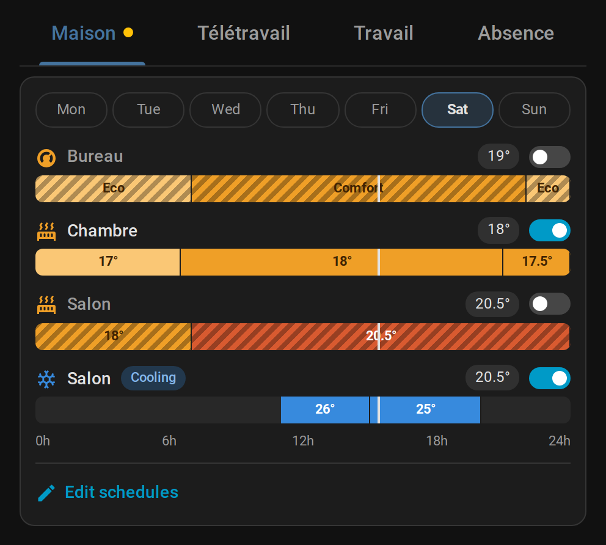

# HomeShift Schedule Card

[](https://github.com/hacs/integration)
[](https://github.com/Gamso/homeshift-schedule-card/actions/workflows/validate.yml)

A Lovelace card for Home Assistant that shows your [Scheduler](https://github.com/nielsfaber/scheduler-component) schedules **per day mode**, as 24 h timelines, in tabs that follow a `select` entity.



---

## Overview

HomeShift Schedule Card is the companion of the [HomeShift integration](https://github.com/Gamso/homeshift) and its `select.homeshift_day_mode` (Home, Remote, Work, Away…), but it works with any `select` or `input_select`. Each option of the entity gets a tab, which shows the schedules tagged with the same name.

It replaces a `tabbed-card` holding one copy of `scheduler-card` per mode with a few lines:

```yaml
type: custom:homeshift-schedule-card
mode_entity: select.homeshift_day_mode
entities:
  - climate.office
  - climate.bedroom
  - climate.living_room
extra_entities:
  Work:
    - input_boolean.force_presence
```

---

## Features

### Mode tabs

One tab per option of the mode entity, in its order: add a mode to the entity and its tab appears. A dot marks the active mode, and the card switches to its tab whenever the mode changes. Left and right arrow keys move between tabs.

### 24 h timelines

Each schedule of the tab is drawn as a timeline of the day, one segment per time slot:

| Segment             | Colour                                   |
| ------------------- | ---------------------------------------- |
| Heating setpoint    | Light yellow to red, warmer when higher  |
| Below 15° (frost)   | Light blue                               |
| Cooling setpoint    | Blue                                     |
| Preset              | Frost, away: light blue · eco: light yellow · comfort: orange · boost: red |
| Turn on / turn off  | Green / gray (also HVAC mode off)        |

- Setpoints, presets ("Comfort", "Eco"…) and HVAC modes are shown as Home Assistant names them, in your language.
- A vertical line marks the current time.
- Next to the name, the room temperature measured by the thermostat, and a **Cooling** badge on cooling schedules to tell them from heating ones on the same room.
- A day selector (Mon → Sun, today by default) shows the schedules of any day of the week: weekday-only schedules disappear on the weekend.
- The switch of each row enables or disables the schedule. A disabled schedule keeps its colours, hatched, so the tabs of inactive modes stay as readable as the active one.
- Back-to-back time slots setting the same value are drawn as one segment.
- A schedule that drives a thermostat shows only its thermostat actions: an "auto start" switch turned on in the same schedule does not clutter the timeline.

The timelines are read from the Scheduler integration and refresh as soon as a schedule is edited, toggled or run.

### Editing schedules

**Edit schedules** shows the [scheduler-card](https://github.com/nielsfaber/scheduler-card) list of the tab, with **Add** and the full editor, already filtered on the tab's tag and entities. **Back to timeline** returns to the timelines. Set `layout: list` to always show that list instead of the timelines.

---

## Requirements

- [scheduler-component](https://github.com/nielsfaber/scheduler-component) (the Scheduler integration)
- [scheduler-card](https://github.com/nielsfaber/scheduler-card), used to add and edit schedules
- A `select` or `input_select` holding the day mode, e.g. `select.homeshift_day_mode` from [HomeShift](https://github.com/Gamso/homeshift)

Tag each schedule with the name of its mode (in the scheduler-card editor, **Options → Tags**): that is how the card knows which tab it belongs to.

---

## Installation

### HACS (recommended)

<a href="https://my.home-assistant.io/redirect/hacs_repository/?owner=Gamso&repository=homeshift-schedule-card&category=plugin"></a>

### Manual

1. Download `homeshift-schedule-card.js` from the [latest release](https://github.com/Gamso/homeshift-schedule-card/releases/latest)
2. Copy it to `config/www/homeshift_schedule_card/homeshift-schedule-card.js`
3. Add the resource in **Settings → Dashboards → Resources**:
   ```
   /local/homeshift_schedule_card/homeshift-schedule-card.js
   ```

---

## Configuration

### Options

| Option              | Default                     | Description                                                                                           |
| ------------------- | --------------------------- | ----------------------------------------------------------------------------------------------------- |
| `mode_entity`       | —                           | `select` or `input_select` of the day mode. Its options give the tabs.                                |
| `modes`             | options of `mode_entity`    | Explicit tabs: `- Home`, or `- name: Away` with optional `label`, `tag` and `entities`.               |
| `entities`          | all                         | Entities offered in every tab (scheduler-card `include`); also filters the timelines.                 |
| `extra_entities`    | —                           | Entities offered in one tab only, by mode name.                                                       |
| `layout`            | `timeline`                  | `timeline`: 24 h timelines; `list`: the scheduler-card list straight away.                            |
| `follow_mode`       | `true`                      | Switch to the active mode's tab when the mode changes.                                                |
| `accent_color`      | `#44739E`                   | Colour of the tabs, day selector and button.                                                          |
| `name_color`        | `orange`                    | Colour of the schedule names in the scheduler-card list.                                              |
| `scheduler`         | see below                   | scheduler-card options merged over the defaults (`time_step`, `sort_by`, `display_options`…).         |

`mode_entity` or `modes` is required. A tab always filters on its own tag and entities: `tags` and `include` under `scheduler` are ignored.

### Explicit modes

```yaml
type: custom:homeshift-schedule-card
mode_entity: select.homeshift_day_mode
follow_mode: false
modes:
  - Home
  - name: Away
    label: Holidays
    tag: holidays
    entities:
      - climate.living_room
```

### scheduler-card defaults

Passed to each scheduler-card, labels in the user's language:

```yaml
title: false
discover_existing: false
show_header_toggle: false
time_step: 5
sort_by: [title]
display_options:
  primary_info:
    - <i><b><font color="orange">{name}</font></b></i>
  secondary_info:
    - <i><b>Next run</b></i> {relative-time}
    - <i><b>Schedule</b></i> {days}
    - additional-tasks
  icon: entity
```

---

## Development

```bash
npm ci
npm run build      # dist/homeshift-schedule-card.js (committed, served by HACS)
npm run typecheck
npm run lint
npm test
```

CI runs the same commands, checks that the committed `dist/` matches a fresh build, and validates the repository with the HACS action.

A Home Assistant devcontainer with Scheduler, simulated thermostats and sample schedules is described in [.devcontainer/README.md](.devcontainer/README.md).

---

## License

MIT
